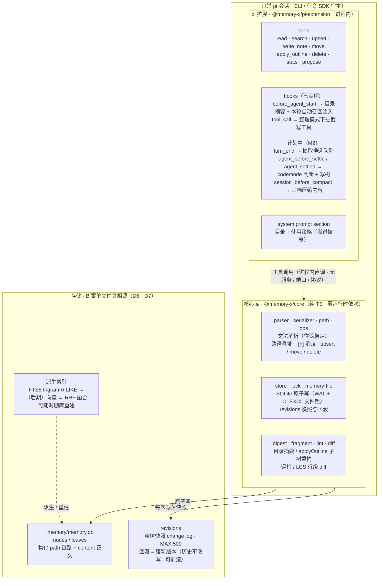

# Memory X — 项目计划

> MindMap X 的蒸馏重建：一棵 Markdown 记忆树 + pi 扩展，为单人 Memory 而生。
> 状态：v0.1 草案（2026-11-16）

## 0. 项目章程

### 目标

- 日常与 pi 的对话中，**在合适的时机**自动/半自动地把结构性信息沉淀进一棵可长期演进的记忆树
- 任何 pi 宿主（CLI / SDK）都能低成本接入：进程内扩展，无服务、无端口、无协议
- 检索分层演进：目录导航 → FTS → （可选）语义向量，每层都可独立交付价值

### 非目标（明确不做）

- 画布 UI（Obsidian / 任何 Markdown 编辑器即视图）
- **Web UI / pi-web 集成（v1 明确不做，TUI/CLI 形态优先，决策 D5）**
- 多人 / 多租户 / 多 Map（单树，顶层分支即"域"）
- HTTP 服务 / GraphQL / MCP（进程内直调）
- 替换 pi 的会话存储（会话归 pi 的 JSONL，记忆归本树，两棵树不搅在一起）

### 核心原则（贯穿所有设计）

| # | 原则 | 推论 |
|---|---|---|
| P1 | **SQLite 是唯一真相（nodes + revisions）**（D6→D7 演进） | 无镜像无 git；版本历史/回滚在 revisions 表；索引/缓存全部可删重建 |
| P2 | **渐进披露** | 常驻注入只有小目录摘要，细节靠工具按需取 |
| P3 | **版本历史在库内**（revisions 整树快照，MAX 500） | 移植 MindMap X 语义：回滚是前进（新版本），历史不改写，可前滚 |
| P4 | **抽取宁缺毋滥** | 垃圾条目烂树；precision 优先于 recall |
| P5 | **单人系统单人信号** | 访问频率、最近使用是免费排序信号，用起来 |

---

## 1. 架构总览

> 本节于 2026-11-18 按 B 案实现重绘。v0.1 草案原为「`MEMORY.md` + `notes/` + git」文件式存储，已被 D6→D7 推翻；
> §2–§3、§9 仍是草案期规格（文件文法 / git 快照 / `MemoryFile` API / `memory/` 为 git 仓库），以 README 与实现为准。



要点：

- **唯一真相源**：SQLite 单文件（`nodes` + `revisions`）；无镜像、无 git、无 `notes/` 派生文件；索引与目录摘要都是可删重建的缓存（P1）。
- **进程内扩展**：无 HTTP / GraphQL / MCP，宿主只有 CLI / SDK 两种形态（非目标）。
- **渐进披露**：常驻注入只有目录摘要（`<memory>` 双 section 之一），细节靠工具按需取；本轮相关记忆另走 `<memory_recall>` 自动召回（P2）。
- **抽取宁缺毋滥**：自动抽取（M2，见 §4.2–4.3）只入队"跨会话仍有价值"的结构信息（P4）。

---

## 2. 存储规范（真相源格式）

### 2.1 MEMORY.md 文法

```markdown
# Memory                      ← 唯一根（H1，固定）

## 工作                       ← 顶层域（H2）
### pi 生态调研               ← 深层节点（H3–H6，最多 5 层深）
- RPC 模式与 SDK 是兄弟关系，共享 core 层 ← 2026-11-16
- pi-web 用 SDK 进程内嵌入，Next.js 全栈 ← 2026-11-16
#### 待办
- 验证 SQLite 镜像方案的崩溃窗口
```

规则：
- **标题 = 结构节点**；标题下的 **bullet = 叶子事实**（一条一行，短句）
- 单条事实超过 ~200 字 → 下沉到 `notes/`，主文件留链接：`- [详见](notes/工作-pi生态调研.md)`
- 时间戳标注：`← YYYY-MM-DD`；来源会话可加 `← 2026-11-16 #s:<sessionId前8位>`
- 软约束：一节点下叶子 ≤ 20 条（超过提示模型考虑拆子节点）

### 2.2 路径寻址

- 格式：`工作/pi生态调研/待办`（标题文本，`/` 分隔）
- 兄弟重名消歧：`项目[2]`（1-based，省略 = [1]）
- `upsertNode` 遇到路径不存在：按**末段标题模糊匹配**（编辑距离）容错；仍失败则报错，模型重读树后重试
- 特殊字符：标题中禁用 `/`；`[` 转义为 `[[`

### 2.3 notes/ 派生文件

- 命名：路径各段 `-` 连接 + `.md`（过长截断 + 短 hash 后缀）
- 创建/更新由 core 管理，人可直接编辑（下次 save 前后的 diff 由 git 兜底）
- notes 也进索引（检索层可见）

### 2.4 原子性与并发

- 写：`MEMORY.md.tmp` 同目录 + `rename` 原子替换；fsync 后再 rename
- 锁：`proper-lockfile` 锁 `memory/` 目录（覆盖"pi 在写、编辑器同时保存"窗口）；拿不到锁 → 等待 2s → 失败报错
- 版本：每次成功 save → 自动 `git commit -m "memory: <op> <path>"`；`memory/` 若非 git 仓库，首次自动 `git init`
- 冲突哲学：单人系统，git 是安全网，不做 merge 逻辑

---

## 3. memory-core API（@memory-x/core）

```ts
class MemoryFile {
  static open(dir: string): Promise<MemoryFile>;

  // 读
  readTree(maxDepth?: number): TreeNode;            // 目录摘要用
  readSection(path: string): Section;               // 子树 + 该节点 notes 链接
  readNote(path: string): string | undefined;

  // 写（全部触发：原子写 + git commit + 索引增量 + onChange）
  upsertNode(path: string, leaf: string): OpResult;
  moveNode(from: string, to: string): OpResult;
  deleteNode(path: string): OpResult;
  applyOutline(path: string, outline: string): OpResult;  // 粗粒度整子树重写
  writeNote(path: string, content: string): OpResult;

  // 检索（分层，见 §5）
  search(query: string, opts?: SearchOpts): SearchHit[];

  // 派生
  tocDigest(maxTokens: number): string;             // P2：目录摘要
  recordAccess(path: string): void;                 // P5：访问信号
}

interface OpResult { ok: boolean; path: string; revision: string; /* git sha */ }
```

约束：
- parse → serialize **往返稳定**（不改变语义字节），fuzz 测试保证
- 无网络、无 watch、无守护进程——纯函数式按需打开

---

## 4. pi 扩展设计（@memory-x/pi-extension）

### 4.1 工具面

| 工具 | 参数 | 说明 | 权限 |
|---|---|---|---|
| `memory_read` | `path` | 读子树（含 notes 链接） | 只读，自动放行 |
| `memory_search` | `query` | 分层检索，top-5 路径+摘要 | 只读，自动放行 |
| `memory_upsert` | `path, leaf` | 新增/更新一条叶子事实 | 默认放行（git 兜底），可配置确认 |
| `memory_apply_outline` | `path, outline` | 整子树重写（大重构用） | 默认需确认（beforeTool hook） |
| `memory_move` | `from, to` | 移动子树 | 默认需确认 |

配置（pi settings）：`autoExtract`（默认 on）、`writeConfirm`（upsert 默认 off / apply_outline+move 默认 on）、`tocMaxTokens`（默认 400）、`searchTopK`（默认 5）。

### 4.2 Hook 接线

```
session 启动
  └─ context_with_system: 注入 tocDigest() + 使用策略段
       （"何时读、何时写、何时搜索"的简短说明）

turn_end（actionable）
  └─ 收集本轮 {assistant 摘要, tool 结果涉及的关键文件/路径}
     → 推入内存抽取队列（不做慢活）

agent_settled
  └─ 批量执行抽取（见 4.3），单次 run 上限 N 条（默认 3）

session_before_compact
  └─ 将被压缩的分支摘要 → 归档候选（走同一抽取管道，标注来源=compaction）
```

### 4.3 抽取管道（时机之核心）

```
候选文本
  → codemode 小模型判断（结构化输出）：
     { worth: boolean, kind: decision|entity|fact|hierarchy, reason }
  → worth=true：让小模型产出 patch { path, leaf }
  → 路径校验（模糊匹配/冲突检测）
  → upsertNode（带时间戳与来源标记）
  → 结果记入 .memory/log（供 /memory review 人工审查）
```

- 判断 prompt 要点：**只收"跨会话仍有价值"的结构信息**（决策、结论、实体关系、长期待办），聊天细节/临时调试一律拒绝
- 保守调参：宁可漏（P4）；垃圾率连续一周 > 20% 时收紧 prompt
- 人工审查命令：`/memory review`（斜杠命令，列出最近自动写入，可回滚 = git revert）

### 4.4 系统提示词段（注入模板，≤ tocMaxTokens）

```
## Memory
你有一棵长期记忆树（工作/生活/项目…目录如下）。
- 需要背景时先 memory_search，再 memory_read 下钻
- 对话中出现值得长期记住的结构性结论时，主动 memory_upsert
- 不确定路径就先读目录，不要猜测写入
<tocDigest>
```

---

## 5. 检索分层规格

### L0 目录导航（M3 交付）
- `tocDigest`：两层标题 + 各节点最近修改时间，≤400 token，会话启动时注入，树变更后下次会话刷新

### L1 词法（M3 交付）
- `node:sqlite` FTS5，trigram tokenizer（中文友好）
- 索引粒度：节点（标题+其下叶子）与 notes 全文
- 增量：按 section content hash，save 时同步更新（毫秒级）
- 查询入口：`memory_search` 工具

### L2 语义（M5，可选，数据说话）
- 本地 embedding：`bge-small-zh-v1.5`（ONNX，worker 线程懒加载，抄 pi-web Photon 模式）
- chunk：子树 ≤512 token，前缀拼面包屑路径（`工作 > pi生态调研：…`）
- 存储：内存数组暴力余弦（规模 <10k chunk 无需 ANN），sqlite 存 blob 做重启缓存
- 隐私默认：**全本地**（个人记忆不出机器；改 API 需显式决策 D1）

### L3 融合（随 L2）
- `RRF(FTS 排名, 向量排名)` + 信号加成：`recency(git mtime 衰减) + access_freq`
- 暂不上 reranker；codemode rerank 留作远期

### 工具驱动 vs 自动注入（决策 D2，默认前者）
- 默认：模型按需 `memory_search`（精准、零噪音）
- 观测指标：新会话中模型主动检索率；若 <30% 再评估自动注入

---

## 6. 评估方法（M4 核心）

- 建立评估集：30+ 条"我知道我记过"的问题（从真实使用中收集，含：路径明确的、跨子树模糊的、中英混的）
- 脚本：`npm run eval` → 输出 hit@1 / hit@3 / MRR
- 每层检索上线前后跑回归；调参只认这个数字，不凭感觉
- 单人语料的注意：避免过拟合评估集，问题按时间滚动补充

---

## 7. 里程碑

### M0 — 核心库骨架（~3 天）
- [x] 仓库初始化（目录见 §9），TS strict + node:test（零依赖，strip-types 直跑）
- [x] Markdown 文法解析/序列化，往返稳定 fuzz（50 随机树）
- [x] 路径寻址 + `[n]` 消歧 + 末段模糊匹配（编辑距离）
- [x] 原子写（`npm run crash-verify`：写入中 SIGKILL，文件不损、无 .tmp 残留）
- [ ] proper-lockfile 集成（跨进程锁，延至 M1 前）
- [x] GitSnapshot：自动 init/commit
- **DoD**：✅ 单测全绿（23/23）；✅ 手工 smoke（upsert→git log 可见历史）

### M1 — pi 扩展最小闭环（~2 天 + 狗粮一周）
- [x] 扩展包脚手架，5 个工具注册（read / upsert / move / apply_outline / stats；search 属 M3）
- [x] tocDigest 注入（`before_agent_start` → `systemPromptOptions.sections.memory`，即 <memory> XML 段）
- [x] 手动写入工作流可用（E2E：pi --print 实测 upsert/read/幂等均通过，git 快照正确）
- [x] M0 遗留：跨进程锁（零依赖 O_EXCL 实现，替代 proper-lockfile，含残留锁接管）
- [ ] 狗粮：真实日常使用 ≥1 周，收集格式工效学问题
- **DoD**：一周内零格式破坏事故；至少 30 条真实记忆入库

### M2 — 自动抽取（~3 天 + 调参一周）
- [ ] turn_end 队列 + agent_settled 批处理
- [ ] codemode 判断 prompt v1 + patch 生成
- [ ] session_before_compact 归档接线
- [ ] `/memory review` 审查命令（列出+一键回滚）
- [ ] notes 下沉逻辑（长正文自动派生）
- **DoD**：连续一周自动抽取，人工审查垃圾率 <20%，无重复条目爆炸

### M3 — 检索 L0/L1（~2 天）
- [x] FTS5 索引 + 增量维护 + memory_search（trigram ≥3 字词 + LIKE 双字词兜底；命中带链路/祖先/兄弟/片段；写入后自动重建，旧库打开时补建）
- [x] 访问信号记录（recordAccess：search/read 命中即记）
- [x] 自动召回：before_agent_start 对用户输入跑检索，top-3 追加进 <memory> 段（双轨：自动兜底 + 工具精准）
- [x] 评估集 v1（15 题真题，本地保存不入库）+ 跑分器（scripts/eval.ts，hit@1/@3/MRR，子树容忍匹配）
- [x] 基线与调优：0.53 → **0.73**（CJK 长词滑窗拆 trigram；剩余 4 miss 全为语义同义型，为向量层的明确依据）
- **DoD**：✅ 52/52 测试；✅ E2E；✅ 基线存档 eval/results/

### M4 — 评估与调优（持续）
- [ ] 评估脚本 + 指标面板（终端表格即可）
- [ ] 调 prompt / topK / 摘要 token 预算
- [ ] 决策：是否需要 L2（命中 plateau 且失败案例属"语义跨树"型才上）
- **DoD**：基线指标稳定，L2 决策记录在案

### M5 — 语义层（可选，~3 天）
- [ ] bge-small-zh worker 加载
- [ ] 树 chunking + 面包屑前缀
- [ ] RRF 融合 + recency/access 加成
- **DoD**：评估集 hit@3 提升 ≥10%，否则回滚（保留代码，配置关闭）

---

## 8. 风险登记

| 风险 | 概率 | 对策 |
|---|---|---|
| 单文件膨胀 | 高（长期） | notes 下沉（M2 起）；主文件只留骨架；检索层不整读文件 |
| 抽取垃圾烂树 | 高 | P4 保守 prompt；/memory review；git 兜底可回滚 |
| 路径寻址被人改标题打断 | 中 | 末段模糊匹配；失败报错引导重读；标题变更频率本身低 |
| codemode 判断成本/延迟 | 中 | 仅 agent_settled 批量跑；单 run 上限 3 条 |
| pi 升级破坏扩展 API | 中 | 锁 pi 包版本；升级跑扩展测试套件 |
| round-trip 漂移破坏 diff 可读性 | 低 | fuzz + 快照测试钉死 |
| 记忆含敏感信息 | 低 | 默认全本地（D1）；不上云 |

---

## 9. 目录结构

```
memory-x/
├── PLAN.md                  # 本文件
├── packages/
│   ├── core/                # @memory-x/core：MemoryFile + Git + Index
│   └── pi-extension/        # @memory-x/pi-extension：tools + hooks
├── eval/                    # 评估集（questions.yaml）与脚本
└── memory/                  # 真实记忆仓（运行时创建，git 仓库）
    ├── MEMORY.md
    ├── notes/
    └── .memory/             # index.db / log（gitignore）
```

技术栈：TypeScript（strict）、Node ≥22.19（对齐 pi，`node:sqlite` 可用）、**node:test（`--experimental-strip-types` 直跑 TS，零测试框架依赖）**、proper-lockfile（M0 后期引入）。**零 Web 框架、零服务、零守护进程。** v1 交互形态：pi TUI 内的斜杠命令与工具调用。

---

## 10. 未决决策

| # | 决策 | 默认值 | 决策时点 |
|---|---|---|---|
| D1 | embedding 本地 vs API | 全本地（隐私） | M5 前 |
| D2 | 检索自动注入 vs 工具驱动 | 工具驱动 | M4 观测后 |
| D3 | 项目最终名字与仓库位置 | `memory-x`（本目录） | M0 |
| D4 | MindMap X fe/ 画布远期复用 | 暂不处理 | 项目稳定后 |
| D5 | v1 交互形态 | 纯 TUI（pi CLI 扩展 + 斜杠命令），不做 Web | 已决（2026-11-16） |
| D6 | 存储架构 | B 案：SQLite 为真相（物化 path + content） | 已决（2026-11-17） |
| D7 | 移除镜像与 git | MEMORY.md 镜像与 git 历史移除；回滚能力以 revisions change log 形式入 SQLite（MindMap X MVCC 语义移植） | 已决（2026-11-18） |
| D8 | 整理（做梦）触发方式 | v1 手动（/memory tidy）；自动定时/闲时触发待 M2 自动抽取一起设计（可接「每日自动整理 + 早上人审 diff」节奏） | 已决：先手动（2026-11-18） |
