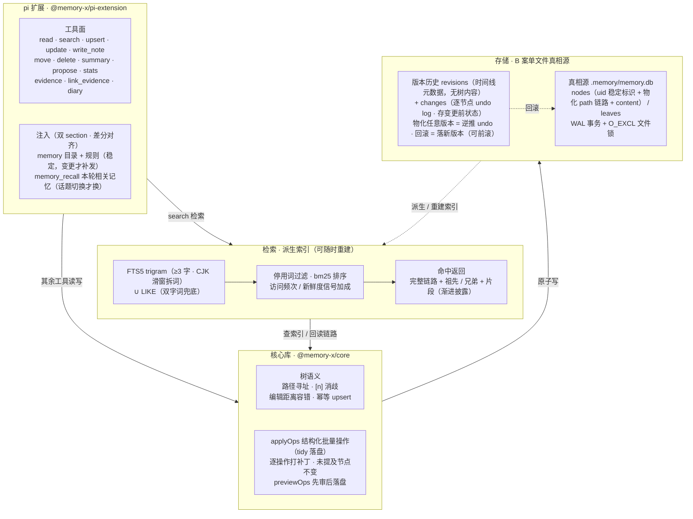

# Memory X

> 一棵给 pi 的长期记忆树 —— [pi coding agent](https://github.com/earendil-works/pi) 的扩展，把日常对话中的结构性信息沉淀进一棵可演进的记忆树。

**你掌舵，它记图** —— 你在终端和 pi 正常工作；值得长期记住的结论、决策、实体关系，被写进一棵 SQLite 为真相、可检索、可回滚、可"做梦"整理的记忆树。下次对话，目录常驻注入，相关记忆自动召回。

## 快速开始（5 分钟装上）

```bash
# 前置：Node ≥ 23.6 + 已安装 pi
npm i -g @earendil-works/pi-coding-agent

git clone https://github.com/allmonday/memory-x.git

# 方式一：全局安装（所有会话生效）
# 在 ~/.pi/agent/settings.json 里把本扩展加入 extensions 数组：
#   "extensions": ["/你的路径/memory-x/packages/pi-extension/index.ts"]

# 方式二：单次会话试用
pi -e /你的路径/memory-x/packages/pi-extension/index.ts
```

装好后**无需任何配置**：扩展会给 pi 注册 13 个 `memory_*` 工具，并在每轮对话注入记忆目录与相关召回。记忆数据在 `~/memory-x/memory/`（`MEMORY_X_DIR` 可改），**永远在本机**——仓库只有代码，不含任何数据。

使用就是正常对话，不用记命令：

```
你：「我用 Neovim，主力项目部署在懒猫微服上」     → 自动写入记忆树（带日期戳）
（三天后的另一场会话）
你：「我编辑器用什么来着？」                      → 目录+召回命中，直接答出
你：「昨天/上周三我干了什么？」                    → memory_diary 日记（读穿缓存）
你：「我之前说偏好 Postgres，现在换 SQLite 了」   → 原地替换旧叶子，不留并存
```

偶尔用到的命令面：`/memory`（看目录）、`/memory tidy`（做梦整理）、`/memory changes` / `rollback <id>`（版本历史与回滚）、`/memory ui`（浏览器视图）。详见下文「使用」。

## 架构

四层结构，向下依赖、逐层收敛到唯一真相源：



- **读路径**：`search` → 派生索引（FTS5 ∪ LIKE，bm25 + 信号加成）→ 回读树拿到完整链路与片段 → 注入 `memory_recall`。
- **写路径**：`upsert` / `update` / `write_note` / `move` / `delete`，以及整理 `tidy`（一批结构化 ops 一次落盘）→ core 树语义与逐操作校验 → 原子落盘（WAL + 文件锁），同时把每个被触碰节点的**变更前状态**按稳定 `uid` 追加到 `changes`（undo log）→ 派生索引增量更新。写入时机械保障：叶子末尾自动附「← 日期」戳（已含则幂等跳过；`MEMORY_X_DATE` 可显式指定），写入规范要求与对话相同语言、保留人名/日期/数字。
- **原始证据（episodes）**：每轮用户发言、助手回复、工具结果按 session 机械采集（session_id + 真实日历时间戳，超长截断），**默认永久保留**（`MEMORY_X_EPISODE_MAX` 可恢复滚动窗口）；`memory_evidence` / `memory_link_evidence` 把叶子事实挂回原始对话片段，结论可追溯。
- **日记（diary）**：`memory_diary` 读穿缓存——按日聚合当天 sessions / 动过的节点 / 素材水位；未缓存则返回原始素材由模型总结落盘 `日记/YYYY-MM-DD`（末行附水位戳），已缓存直接命中并做水位失效检测（之后又有新事件则标注可重建）。历史日期（库启用前）兑底查叶子「← 日期」标记的弱视图。
- **整理（tidy）**：模型读记忆树（Markdown 只作只读 review 视图）→ 调 `memory_propose(ops)` 提交**结构化操作列表**（`add_leaf`/`update_leaf`/`remove_leaf`/`rename`/`move`/`add_node`/`delete`/`set_note`/`set_summary`）→ **直接落盘为一个版本**（对克隆树先干跑校验，失败整批回滚；成功则按序原子应用）。不重写整棵树，未提及的节点保持不变。本轮 tidy 的变更可在 `/memory changes`（按版本分组）看到，`/memory rollback <id>` 回滚。
- **可回滚**：任意版本由「当前态 + 逆推 `revision_id > target` 的 undo 行」物化；`/memory rollback <id>` 只是再落一版，不改写历史，因此可前滚。`/memory changes` 的逐条变更由 undo 行 + 物化态**派生**，不另占存储。

## 使用

对话中模型自主读写检索；你的命令面：

```
/memory                    # 看记忆目录
/memory tidy               # 整理（做梦）：弹树选范围（节点=局部 / 整棵树=全局）→ 模型提交结构化操作 → 直接落盘为一个版本（可回滚）
/memory tidy <节点路径>     # 直接指定局部整理范围（懒得打路径可无参弹树选择）
/memory tidy [<路径>] -- <指导语>  # 追加整理指导（注入整理 prompt，如"合并重复，保留最近3个月"）
/memory changes            # 最近变更（按版本分组，含 op/detail，挑版本回滚）
/memory log                # 版本历史（change log）
/memory rollback <id>      # 回滚到指定版本（历史保留，可再滚回来）
/memory stats              # 规模统计
/memory dump [--full] [文件]  # 整树导出
/memory ui                 # 在独立终端拉起只读 Web UI（见下文）
```

**整理（做梦）的安全设计**：方案只进草稿不落盘；整理模式下所有写工具被 `tool_call` 拦截器封禁；落盘前人审 diff（+N/-N 行）；apply 后仍可 rollback。支持**局部整理**——指定节点（或弹树选择）只重写该子树，且原样保留其 `content`（完整信息），不动树中其它部分。

**日记**：对话里直接问「昨天/某天干了什么」，模型走 `memory_diary`——首次查询按日聚合当天 sessions 与动过的节点（素材来自 episodes + 版本审计，纯机械派生），总结落盘为缓存；再次查询直接命中。可与结构化节点交叉验证：日记条目引用节点路径，节点变更史反查日期。

文法（严格模式，非法行直接报错）：

```markdown
# Memory

## 工作
### pi 生态调研
- RPC 模式与 SDK 模式共享 core 层 ← 2026-11-16

#### 待办
- 验证崩溃窗口

### 调研正文
```（fenced block = 节点完整信息（Markdown 正文），RAG 语料；UI 按 Markdown 渲染）
```
```

## 环境变量

| 变量 | 默认 | 说明 |
|---|---|---|
| `MEMORY_X_DIR` | `~/memory-x/memory` | 记忆仓目录 |
| `MEMORY_X_INJECT_MIN` | `1.0` | 自动召回注入分数闸门（噪音控制） |
| `MEMORY_X_UI_PORT` | `7320` | 只读 Web UI 端口 |
| `MEMORY_X_CAPTURE` | `on` | `off` 关闭原始证据采集（episodes） |
| `MEMORY_X_EPISODE_MAX` | `0`（永久保留） | 正数 = 只保留最新 N 条 episodes（滚动窗口） |
| `MEMORY_X_DATE` | （不设） | 显式指定叶子日期戳的「今天」（YYYY-MM-DD；replay/测试用，如评测脚本逐 turn 设置对话日期） |

## 只读 Web UI

UI 是**独立进程**，与 pi session 解耦（多个 session/终端共享同一实例，看到的是同一份记忆）：

```bash
npm run ui                      # 等价于 memory-x ui，只读浏览器视图
npm link && memory-x ui         # 装成全局命令后，任意目录可用（别名 mx ui）
# 选项：--dir <记忆目录> --port <端口> --host <地址> --no-open
```

前台运行，**Ctrl-C 退出**（无 daemon/pidfile）。端口已有 UI 在跑时自动复用。
在 pi 内也可用 `/memory ui`：它会在**独立终端**里拉起该进程（不会占用 pi 终端，也不随 pi 退出而死）。

功能面：

- **树视图**：左侧目录树（[n]=叶子数），右侧节点内容（叶子列表 + `content` 正文按 Markdown 渲染）
- **全文搜索**：顶部搜索框（与 `memory_search` 同源 FTS，命中高亮）
- **版本历史**：右侧版本列表（结构化 changes，每条变更显示 OLD→NEW；时间按本地时区展示，近 3 天用相对时间）；点任意版本可看与当前的**着色 diff**（绿增/红删），并提示对应 `/memory rollback <id>` 命令
- **lint 视图**：结构守卫提示（深层嵌套/叶子过多等，与 `/memory` 的软提示同源）

## 测试与评估

```bash
npm test              # 119 项：文法/路径/操作/存储/版本回滚/检索/整理/迁移/锁/fuzz/并发写/采集/日记
npm run eval:halumem   # HaluMem 记忆评测（pi-live：pi SDK 真实会话 × 生产 extension，见 eval/halumem/README.md）
npm run crash-verify  # 写入中 SIGKILL，验证 db 完好（WAL）
```

运行时零依赖（**Node ≥ 23.6**，`node:sqlite` + 原生 TS 直跑，扩展/核心库不需要 npm install、不需要系统 SQLite、运行时不碰 git）；评测脚本需要 `npm install`（devDependency：pi SDK）。
当前评测水位（记录 1）：pi-live 组合问答 0.738（全量重跑外推 ≈0.84）、recall 0.955、precision 叶级 0.856——详见 eval/halumem/README.md。

## 路线图

- [x] M0 核心库（解析/寻址/原子性/锁）
- [x] M1 pi 扩展最小闭环（工具 + TOC 注入）
- [x] B 案存储（SQLite 真相 + 物化链路 + content 正文）
- [x] 版本历史与回滚（revisions change log，移植自 MindMap X MVCC 语义）
- [x] M3 检索（FTS+LIKE 双通道、停用词、访问/新鲜度信号、自动召回闸门、评估设施）
- [x] 整理（做梦）：手动触发，草稿-人审-落盘三段式
- [x] P4 原始证据采集（episodes 永久保留 + evidence 溯源链接）
- [x] 日记（dayDigest 按日派生 + memory_diary 读穿缓存 + 弱视图兑底）
- [x] pi-live 评测体系（pi SDK 真实会话 × 生产 extension；HaluMem 基准，判分分流）
- [ ] M2 软更新替换（偏好/关系类演变的隐式 supersede；评测已知主要缺口，precision 0.856）
- [ ] M5 语义向量层（bge-small-zh + RRF 融合；检索层实测非瓶颈，低优先）

详见 [PLAN.md](./PLAN.md)。

## License

MIT
