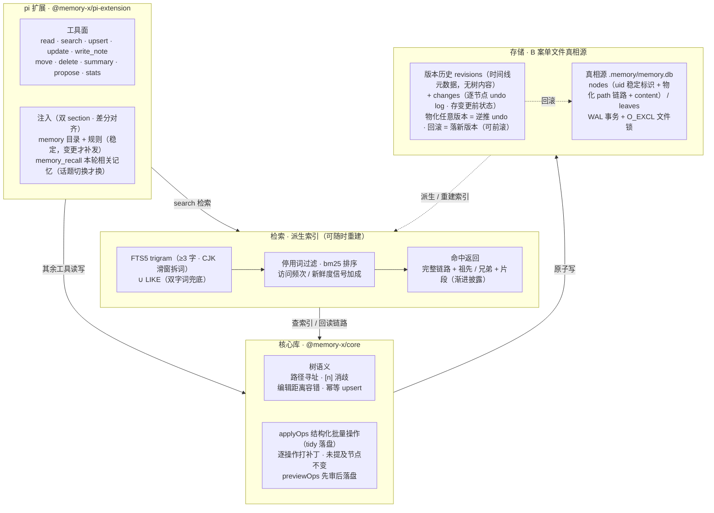

# Memory X

> 一棵给 pi 的长期记忆树 —— [pi coding agent](https://github.com/earendil-works/pi) 的扩展，把日常对话中的结构性信息沉淀进一棵可演进的记忆树。

**你掌舵，它记图** —— 你在终端和 pi 正常工作；值得长期记住的结论、决策、实体关系，被写进一棵 SQLite 为真相、可检索、可回滚、可"做梦"整理的记忆树。下次对话，目录常驻注入，相关记忆自动召回。

## 架构

四层结构，向下依赖、逐层收敛到唯一真相源：



- **读路径**：`search` → 派生索引（FTS5 ∪ LIKE，bm25 + 信号加成）→ 回读树拿到完整链路与片段 → 注入 `memory_recall`。
- **写路径**：`upsert` / `update` / `write_note` / `move` / `delete`，以及整理 `tidy`（一批结构化 ops 一次落盘）→ core 树语义与逐操作校验 → 原子落盘（WAL + 文件锁），同时把每个被触碰节点的**变更前状态**按稳定 `uid` 追加到 `changes`（undo log）→ 派生索引增量更新。
- **整理（tidy）**：模型读记忆树（Markdown 只作只读 review 视图）→ 调 `memory_propose(ops)` 提交**结构化操作列表**（`add_leaf`/`update_leaf`/`remove_leaf`/`rename`/`move`/`add_node`/`delete`/`set_note`/`set_summary`）→ `tidy show` 对克隆树预演并展示结构差异 → `tidy apply` 按序原子应用（任一条失败整批回滚）。不重写整棵树，未提及的节点保持不变。
- **可回滚**：任意版本由「当前态 + 逆推 `revision_id > target` 的 undo 行」物化；`/memory rollback <id>` 只是再落一版，不改写历史，因此可前滚。`/memory changes` 的逐条变更由 undo 行 + 物化态**派生**，不另占存储。

## 快速开始

```bash
git clone https://github.com/allmonday/memory-x.git

# 装进你的 pi（全局）
# ~/.pi/agent/settings.json:
#   "extensions": ["<clone路径>/packages/pi-extension/index.ts"]

# 或单次会话试用
pi -e <clone路径>/packages/pi-extension/index.ts
```

记忆数据默认在 `~/memory-x/memory/`（`MEMORY_X_DIR` 可改）。**你的记忆永远在本机**——这个仓库只有代码，不含任何数据。

## 使用

对话中模型自主读写检索；你的命令面：

```
/memory                    # 看记忆目录
/memory tidy               # 整理（做梦）：弹树选范围（节点=局部 / 整棵树=全局）→ 模型出结构化操作草稿（ops）→ show 预演 → apply 确认落盘
/memory tidy <节点路径>     # 直接指定局部整理范围（懒得打路径可无参弹树选择）
/memory tidy [<路径>] -- <指导语>  # 追加整理指导（注入整理 prompt，如"合并重复，保留最近3个月"）
/memory tidy show|apply|discard
/memory log                # 版本历史（change log）
/memory rollback <id>      # 回滚到指定版本（历史保留，可再滚回来）
/memory stats              # 规模统计
/memory dump [--full] [文件]  # 整树导出
```

**整理（做梦）的安全设计**：方案只进草稿不落盘；整理模式下所有写工具被 `tool_call` 拦截器封禁；落盘前人审 diff（+N/-N 行）；apply 后仍可 rollback。支持**局部整理**——指定节点（或弹树选择）只重写该子树，且原样保留其 `content`（完整信息），不动树中其它部分。

文法（严格模式，非法行直接报错）：

```markdown
# Memory

## 工作
### pi 生态调研
- RPC 模式与 SDK 模式共享 core 层 ← 2026-11-16

#### 待办
- 验证崩溃窗口

### 调研正文
```（fenced block = 节点完整信息（Markdown 正文），RAG 语料；UI 按 Markdown 渲染）
```
```

## 环境变量

| 变量 | 默认 | 说明 |
|---|---|---|
| `MEMORY_X_DIR` | `~/memory-x/memory` | 记忆仓目录 |
| `MEMORY_X_INJECT_MIN` | `1.0` | 自动召回注入分数闸门（噪音控制） |
| `MEMORY_X_UI_PORT` | `7320` | 只读 Web UI 端口 |

## 只读 Web UI

UI 是**独立进程**，与 pi session 解耦（多个 session/终端共享同一实例，看到的是同一份记忆）：

```bash
npm run ui                      # 等价于 memory-x ui，只读浏览器视图
npm link && memory-x ui         # 装成全局命令后，任意目录可用（别名 mx ui）
# 选项：--dir <记忆目录> --port <端口> --host <地址> --no-open
```

前台运行，**Ctrl-C 退出**（无 daemon/pidfile）。端口已有 UI 在跑时自动复用。
在 pi 内也可用 `/memory ui`：它会在**独立终端**里拉起该进程（不会占用 pi 终端，也不随 pi 退出而死）。

## 测试与评估

```bash
npm test              # 80 项：文法/路径/操作/存储/版本回滚/检索/整理/迁移/锁/fuzz/并发写
npm run eval          # 检索质量评估（hit@1/@3/MRR；当前 0.73，题集本地保存不入库）
npm run crash-verify  # 写入中 SIGKILL，验证 db 完好（WAL）
```

零运行时依赖（**Node ≥ 23.6**，`node:sqlite` + 原生 TS 直跑；无需 npm install、无需系统 SQLite、运行时不碰 git）。

## 路线图

- [x] M0 核心库（解析/寻址/原子性/锁）
- [x] M1 pi 扩展最小闭环（工具 + TOC 注入）
- [x] B 案存储（SQLite 真相 + 物化链路 + content 正文）
- [x] 版本历史与回滚（revisions change log，移植自 MindMap X MVCC 语义）
- [x] M3 检索（FTS+LIKE 双通道、停用词、访问/新鲜度信号、自动召回闸门、评估设施）
- [x] 整理（做梦）：手动触发，草稿-人审-落盘三段式
- [ ] M2 自动抽取（turn_end → codemodel 判断 → 入图；自动做梦节奏）
- [ ] M5 语义向量层（bge-small-zh + RRF 融合，评估达标才保留）

详见 [PLAN.md](./PLAN.md)。

## License

MIT
